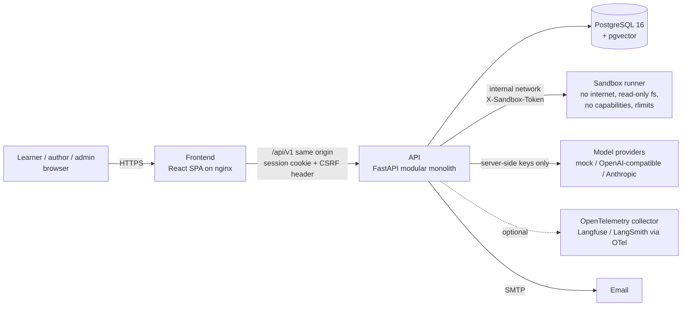
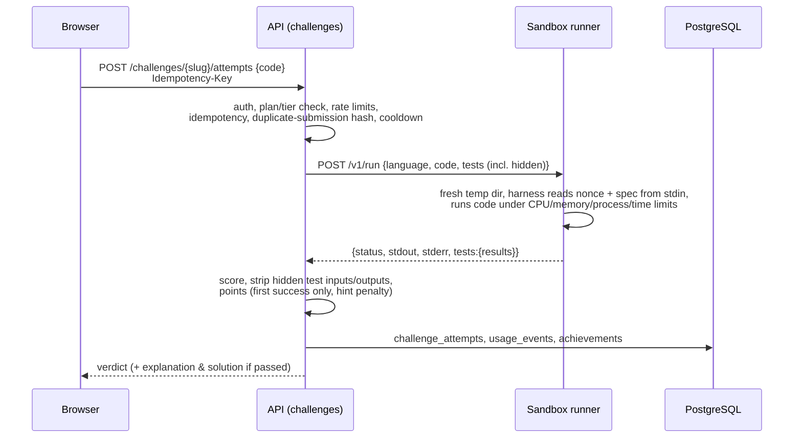
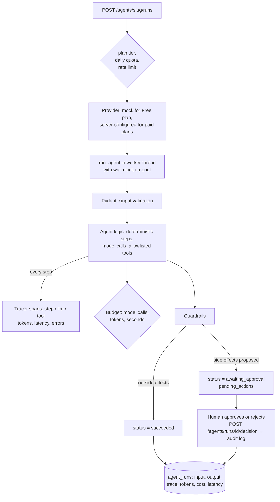
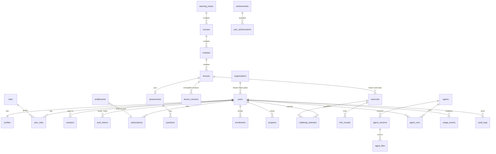

# Architecture

AgentForge Academy is a **modular monolith**: one FastAPI application with clear module boundaries, one PostgreSQL database, and one separate service only where isolation is a security requirement: the **sandbox runner** that executes learner code. Microservices would add operational cost without a scaling problem to justify them; module boundaries keep the option open.

## System context



| Component | Responsibility | Key technology |
|---|---|---|
| `frontend/` | SPA: catalog, lessons, lab, challenges, agent library, admin CMS | React 19, TypeScript, Vite, Tailwind 4, Radix (shadcn-style), TanStack Query, Monaco, Mermaid, Recharts |
| `backend/` | API, auth, content, grading orchestration, agent runs, analytics | FastAPI, Pydantic v2, SQLAlchemy 2, Alembic, psycopg 3, Argon2id |
| `agents/` | Provider adapters, agent runtime (budgets, tracing), 10 reference agents, 100-entry catalog, eval harness | Plain Python, Pydantic, httpx, jsonschema |
| `sandbox/` | Runs untrusted Python / JavaScript / SQLite with limits; test harnesses | FastAPI, subprocess + rlimits, container hardening |
| PostgreSQL | System of record; JSONB for versioned content and traces | PostgreSQL 16 (pgvector image ready for Phase 4) |

## Backend module map

```
app/
├── core/       config (env-only, production guards) · db · errors (one envelope) · middleware · ratelimit · security
├── models/     identity · learning · agents · platform (workflows, prompts, evals, billing, analytics, audit)
├── modules/    auth · learning · challenges · codelab · agents · admin · misc · prompts · rag · evals · builder · career   ← routers, thin
├── services/   sandbox client · achievements · common (audit, events, entitlements, email, pagination)
│               llm (provider choice per plan, quotas, cost) · assertions · templating
│               rag/ (chunking, embeddings, retrieval: pgvector or Python cosine, BM25, RRF, rerank; pipeline, evaluation)
│               builder/ (node registry and validation, allowlisted tools, executor with budgets and approvals)
│               interview_scoring (transparent rubric; optional model grading cross-checked by the rubric)
└── seed/       loader + YAML/Markdown content
```

Modules talk to each other through services and models, never through HTTP. Every response error uses `{"error": {"code", "message", "details", "trace_id"}}`, and every request gets a trace id (honouring a safe `X-Request-Id`) that appears in logs, audit rows and agent runs.

## Key flows

### Sign-in and authenticated requests

```mermaid
sequenceDiagram
    participant B as Browser
    participant A as API
    participant D as PostgreSQL
    B->>A: GET /auth/csrf
    A-->>B: Set-Cookie af_csrf (readable), {csrf_token}
    B->>A: POST /auth/login {email, password}<br/>X-CSRF-Token = af_csrf
    A->>A: CSRF double-submit + Origin check, rate limit (IP + account)
    A->>D: user by email; Argon2id verify (constant-time dummy hash if absent)
    A->>D: INSERT sessions (sha256(token), expires_at)
    A-->>B: Set-Cookie af_session (HttpOnly, SameSite=Lax, Secure in prod)
    B->>A: GET /me/dashboard (cookie)
    A->>D: session by token hash → user → plan (subscriptions)
```

Sessions are server-side, so sign-out, "sign out everywhere" and password reset revoke them immediately. Tokens for email verification and reset are single-use, hashed, and expire (48 h / 30 min).

### Grading a code challenge



If no sandbox is configured, the attempt is stored as `not_graded` with zero points and the UI says why. The API process never executes learner code.

### Running a reference agent



### Content publishing

Lessons are immutable `lesson_versions`. Authors save drafts (validated for all required sections), submit for review, and a **different** reviewer publishes; the previous version is archived and the lesson points to the new one. Every transition is audit-logged. The seed loader uses the same model: changed repository content becomes a new published version, never an in-place edit.

## Agent runtime design

- **Provider protocol** (`agents/core/llm.py`): `complete(CompletionRequest) -> Completion`, with `MockProvider` (deterministic, per-task responders), `OpenAICompatibleProvider` (OpenAI, Azure-compatible gateways, Ollama, vLLM) and `AnthropicProvider`. Structured output uses JSON extraction + Pydantic validation with one repair retry.
- **Budgets**: max model calls, total tokens and seconds per run; exceeding any stops the run as `failed` with the reason.
- **Tools**: registered with JSON schemas, validated arguments, and a `side_effect` flag. Side-effect tools are never executed by the agent; they are returned as `pending_actions` for human approval.
- **Untrusted data**: retrieved documents, diffs, logs and tool outputs are fenced as data in prompts; guardrails re-check outputs (for example, dropping review comments on lines not in the diff, or citations to passages that weren't retrieved).
- **Self-documenting**: the agent detail page reads prompts, tool schemas, input schema, folder structure and source files from the code (`registry.py`), so documentation can't drift from what runs.

## Database schema

41 tables, UUID primary keys, explicit foreign keys with `ON DELETE` behaviour, check constraints for enums, unique constraints for natural keys, and indexes for every hot query. JSONB stores versioned content, specs, traces and analytics properties.



| Area | Tables |
|---|---|
| Identity & access | `users`, `profiles`, `roles`, `user_roles`, `sessions`, `auth_tokens`, `organizations`, `credential_refs` |
| Learning | `learning_tracks`, `courses`, `modules`, `lessons`, `lesson_versions`, `enrollments`, `progress`, `assessments`, `questions` |
| Challenges | `exercises` (lesson exercises and standalone challenges; grading spec server-only), `challenge_attempts`, `hint_reveals` |
| Agents | `agents`, `agent_versions` (blueprint, example runs, eval report), `agent_files`, `agent_runs` (trace, tokens, cost, approvals) |
| Phase 4–5 (schema ready) | `workflows`, `workflow_nodes`, `workflow_edges`, `prompt_templates`, `prompt_versions`, `evaluations`, `evaluation_cases` |
| Engagement | `achievements`, `user_achievements`, `projects`, `portfolios`, `portfolio_entries`, `announcements` |
| Billing | `subscriptions` (provider fields null until a payment provider exists), `entitlements` |
| Operations | `usage_events` (allowlisted, non-personal properties), `audit_logs` |

Secrets never live in ordinary rows: `credential_refs` stores a *reference* (for example a Secrets Manager ARN) and the last four characters only, and workflow node configs may reference credentials by id only.

Migrations live in `backend/alembic/versions`; CI runs `alembic check` to fail if models and migrations diverge.

## API

Versioned REST under `/api/v1`, documented at `/api/v1/docs` (OpenAPI 3.1). Lists are paginated (`page`, `page_size`) and filterable; unsafe requests need the CSRF header; `POST /challenges/{slug}/attempts` honours `Idempotency-Key`.

| Area | Endpoints |
|---|---|
| Auth | `GET /auth/csrf` · `POST /auth/register` · `POST /auth/login` · `POST /auth/logout` · `POST /auth/logout-all` · `GET /auth/me` · `POST /auth/verify-email` · `POST /auth/resend-verification` · `POST /auth/password-reset/request` · `POST /auth/password-reset/confirm` |
| Profile | `GET, PATCH /me/profile` · `GET /me/dashboard` · `GET /me/progress` |
| Catalog & lessons | `GET /tracks` · `GET /tracks/{slug}` · `POST /tracks/{slug}/enroll` · `GET /lessons/{slug}` · `POST /lessons/{slug}/quiz` · `POST /lessons/{slug}/progress` · `GET /achievements` · `GET /projects` · `GET /plans` · `GET /announcements` |
| Challenges | `GET /challenges` · `GET /challenges/daily` · `GET /challenges/{slug}` · `POST /challenges/{slug}/hints/{index}` · `POST, GET /challenges/{slug}/attempts` |
| Code lab | `GET /sandbox/status` · `POST /sandbox/run` |
| Agents | `GET /agents` · `GET /agents/{slug}` · `GET /agents/{slug}/files/{path}` · `POST /agents/{slug}/runs` · `GET /agents/runs/mine` · `GET /agents/runs/{id}` · `POST /agents/runs/{id}/decision` |
| Prompt lab | `GET /prompts/templates` · `GET /prompts/templates/{slug}` · `POST /prompts/templates/{slug}/fork` · `POST /prompts/templates/{slug}/versions` · `PUT /prompts/templates/{slug}/test-cases` · `POST /prompts/run` · `POST /prompts/compare` |
| RAG lab | `GET /rag/options` · `GET, POST /rag/datasets` · `GET /rag/datasets/{key}` · `POST /rag/datasets/{key}/documents` · `DELETE /rag/datasets/{key}/documents/{id}` · `POST /rag/datasets/{key}/chunk-preview` · `POST /rag/query` · `POST /rag/evaluate` |
| Evaluations & models | `GET /evaluations` · `GET /evaluations/{id}` · `GET /evaluations/{a}/compare/{b}` · `POST /agents/{slug}/evaluate` · `GET /llm-lab/catalog` · `GET /llm-lab/providers` |
| Agent Builder | `GET /builder/node-types` · `GET /builder/templates` · `GET, POST /builder/workflows` · `GET, PUT, DELETE /builder/workflows/{id}` · `POST /builder/validate` · `POST, GET /builder/workflows/{id}/runs` · `GET /builder/runs/{id}` · `POST /builder/runs/{id}/decision` · `POST /builder/runs/{id}/cancel` |
| Career | `GET /interviews/tracks` · `GET /interviews/questions` · `POST, GET /interviews/sessions` · `GET /interviews/sessions/{id}` · `POST /interviews/sessions/{id}/answers` · `POST /interviews/sessions/{id}/finish` · `GET, PATCH /me/portfolio` · `POST /me/portfolio/entries` · `PUT, DELETE /me/portfolio/entries/{id}` · `POST /me/portfolio/entries/{id}/submit` · `GET /portfolios/{slug}` · `GET /admin/portfolio-reviews` · `POST /admin/portfolio-entries/{id}/review` · `GET /mentor/status` · `GET, POST /mentor/assessment` · `GET /mentor/recommendations` · `POST /mentor/ask` · `GET, DELETE /mentor/history` |
| Admin | `GET /admin/lessons` · `GET /admin/lessons/{id}` · `POST /admin/lessons/{id}/versions` · `POST /admin/lesson-versions/{id}/submit\|publish\|reject` · `GET /admin/reviews` · `POST /admin/attempts/{id}/review` · `GET /admin/users` · `PATCH /admin/users/{id}/plan` · `GET /admin/audit-logs` · `GET /admin/analytics` · `POST /admin/announcements` |
| Health | `GET /healthz` (liveness) · `GET /readyz` (database) |

Agent runs are synchronous with a server-side timeout (typical runs finish in milliseconds with the mock provider and seconds with real models). Streaming via SSE is deferred until runs are moved to a worker queue (see the backlog), where it is actually needed.

## Frontend structure

```
src/
├── lib/          api client (CSRF, error envelope), auth context, types, theme
├── components/   ui primitives (shadcn-style on Radix), layout (sidebar, ⌘K palette), CodeRunner,
│                 Monaco (bundled locally, no CDN), TraceView, Mermaid, Markdown, CodeBlock
└── pages/        Landing, auth, Dashboard, Paths, Lesson, CodeLab, Challenges, ChallengeWorkspace,
                  Agents, AgentDetail, Projects, Progress, Settings, Pricing, Planned, admin/*,
                  labs/{PromptLab, RagLab, ModelsLab}, Evaluations, builder/{BuilderHome, BuilderStudio (React Flow)},
                  Interviews, Portfolio (+ public /u/:slug), Mentor
```

Routes are code-split; Monaco and Mermaid load only on pages that need them. The production CSP forbids inline and third-party scripts.

## Observability

- Structured JSON logs with `trace_id`, path, method, status and duration for every request.
- `X-Trace-Id` response header; error envelopes include it so users can quote it.
- Agent runs persist their spans; when `opentelemetry-api` is installed, spans are also emitted to your collector (Langfuse and LangSmith ingest OTel).
- `/healthz` and `/readyz` for orchestrators; admin analytics for activation, retention, completion, agent engagement, conversion and inference cost.
