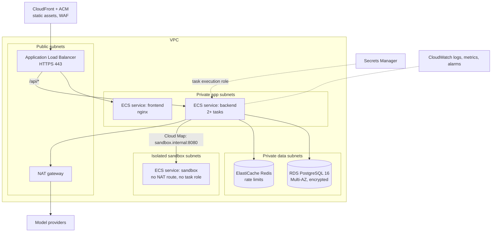

# Deployment guide

The application ships as three container images: **frontend** (nginx serving the SPA and proxying `/api`), **backend** (FastAPI; runs migrations on start), and **sandbox** (code runner). Any container platform works; this guide targets AWS.

## Option A: a single VM with Docker Compose (staging, small cohorts)

Good for a pilot of a few hundred learners.

1. Launch an EC2 instance (2 vCPU / 4 GB is enough to start; `t3.medium`), Amazon Linux 2023 or Ubuntu, with Docker and the Compose plugin. Open only 443 (and 22 from your IP, or use SSM Session Manager instead).
2. Clone the repository and create `.env` from `.env.example` with production values:
   ```bash
   ENV=production
   COOKIE_SECURE=true
   FRONTEND_URL=https://academy.example.com
   CORS_ORIGINS=https://academy.example.com
   MAIL_BACKEND=smtp            # plus SMTP_* (Amazon SES SMTP credentials work)
   SANDBOX_TOKEN=$(openssl rand -hex 32)
   POSTGRES_PASSWORD=$(openssl rand -hex 24)
   SEED_ADMIN_EMAIL=you@example.com
   SEED_ADMIN_PASSWORD=<a strong unique password>
   TRUSTED_PROXIES=2            # load balancer + nginx
   ```
3. `docker compose up -d --build`
4. Terminate TLS in front of port 8080 with an Application Load Balancer + ACM certificate, or Caddy/Traefik on the host.
5. Back up the `pgdata` volume (or point `DATABASE_URL` at RDS, recommended).

## Option B: ECS on Fargate (production)



### Steps

1. **Network.** VPC with public, private-app, private-data and isolated-sandbox subnets across two AZs. Route tables: app subnets → NAT (for model providers and SMTP); sandbox subnets → **no** NAT and no internet gateway. Add VPC endpoints for ECR, CloudWatch Logs and Secrets Manager so tasks can pull images and log without internet.
2. **Security groups.** ALB: 443 from the internet. Frontend and backend: from ALB only. Sandbox: 8080 from the backend security group only. RDS: 5432 from backend only. Redis: 6379 from backend only.
3. **Images.** Push to ECR from CI with GitHub OIDC (no long-lived AWS keys):
   ```bash
   docker build -t $ECR/agentforge-backend:$SHA -f backend/Dockerfile .
   docker build -t $ECR/agentforge-frontend:$SHA frontend
   docker build -t $ECR/agentforge-sandbox:$SHA sandbox
   ```
4. **Database.** RDS PostgreSQL 16, Multi-AZ, storage encryption, automated backups (7–35 days), deletion protection, Performance Insights. Install `pgvector` (`CREATE EXTENSION vector;`) ahead of Phase 4.
5. **Secrets.** Store `DATABASE_URL`, `SANDBOX_TOKEN`, `SMTP_PASSWORD`, `OPENAI_API_KEY` / `ANTHROPIC_API_KEY` and `SEED_ADMIN_PASSWORD` in Secrets Manager; reference them in task definitions via `secrets`. The task *execution* role reads them; the backend task role needs no other AWS permissions. The sandbox task has **no** task role and no secrets except `SANDBOX_TOKEN`.
6. **Task definitions.**
   - backend: 0.5 vCPU / 1 GB, 2+ tasks, health check `/healthz`, `RUN_MIGRATIONS=0` (run migrations as a one-off task, step 7), `SEED_ON_START=0`.
   - sandbox: 1 vCPU / 1 GB, `readonlyRootFilesystem: true`, a 64 MB tmpfs volume at `/tmp`, `user: 10001`, `linuxParameters.capabilities.drop: ["ALL"]`, `initProcessEnabled: true`. Fargate doesn't offer gVisor; for kernel-level isolation run the sandbox on EC2 capacity with `runsc` or on Firecracker (backlog H-02).
   - frontend: 0.25 vCPU / 0.5 GB. Set the nginx upstream to the backend's Cloud Map name, or route `/api/*` at the ALB directly to the backend target group (then nginx only serves static files).
7. **Migrations and seed.** On each deploy, before shifting traffic, run a one-off backend task: `alembic upgrade head`, and on first deploy `python -m app.seed`. Keep migrations backward compatible (expand → migrate → contract) so old and new tasks can run side by side during rolling deploys.
8. **Deploy.** ECS rolling deployment with the deployment circuit breaker and automatic rollback enabled, or CodeDeploy blue/green for the backend.
9. **Edge.** CloudFront in front of the ALB with ACM certificates, HTTP→HTTPS redirect, HSTS (`max-age=31536000; includeSubDomains`), and AWS WAF managed rule groups (core rule set, known bad inputs, IP reputation) plus a rate-based rule on `/api/v1/auth/*`.

### Scaling notes

- The API is stateless (sessions in PostgreSQL). Before running more than one replica, replace the in-memory rate limiter with Redis (backlog H-01) so limits are global.
- Scale the sandbox service on CPU; each task runs `SANDBOX_MAX_CONCURRENCY` jobs at once.
- Agent runs with real models can take seconds: move them to an SQS-backed worker service when p95 exceeds your ALB idle timeout, and stream status to clients (backlog P5-06).

## Observability

- **Logs:** both services log JSON to stdout → CloudWatch Logs (awslogs driver). Filter by `trace_id`; users see it in error messages.
- **Metrics and alarms:** ALB 5xx rate and p95 latency, ECS CPU/memory, RDS CPU/connections/free storage, sandbox timeouts (log metric filter on `"timed_out": true`), daily inference cost from `agent_runs.cost_usd` (admin analytics).
- **Tracing:** install `opentelemetry-api` and an OTLP exporter in the backend image to forward agent spans to your collector (AWS Distro for OpenTelemetry, Langfuse or LangSmith).

## Rough monthly cost (us-east-1, small production)

| Item | Assumption | ~USD |
|---|---|---|
| Fargate | backend 2 × 0.5 vCPU/1 GB, sandbox 2 × 1 vCPU/1 GB, frontend 1 × 0.25/0.5 | 90 |
| RDS PostgreSQL | db.t4g.small Multi-AZ, 20 GB gp3 | 60 |
| ALB | 1 ALB, low LCU | 20 |
| NAT gateway | 1 AZ + modest data | 35 |
| ElastiCache Redis | cache.t4g.micro | 12 |
| CloudFront, WAF, logs, Secrets Manager | low traffic | 20–30 |
| **Total (excl. model usage)** | | **~240–250** |

Model usage is the variable cost: Free-plan learners use the mock provider (zero cost); paid plans are bounded by per-run budgets and daily quotas. Verify prices with the AWS Pricing Calculator for your region.

## Rollback

- Application: redeploy the previous image tag (ECS keeps the previous task definition revision).
- Database: migrations are written to be backward compatible; for a bad migration, restore from the RDS snapshot taken by the pre-deploy step, or `alembic downgrade -1` when the migration is reversible.
